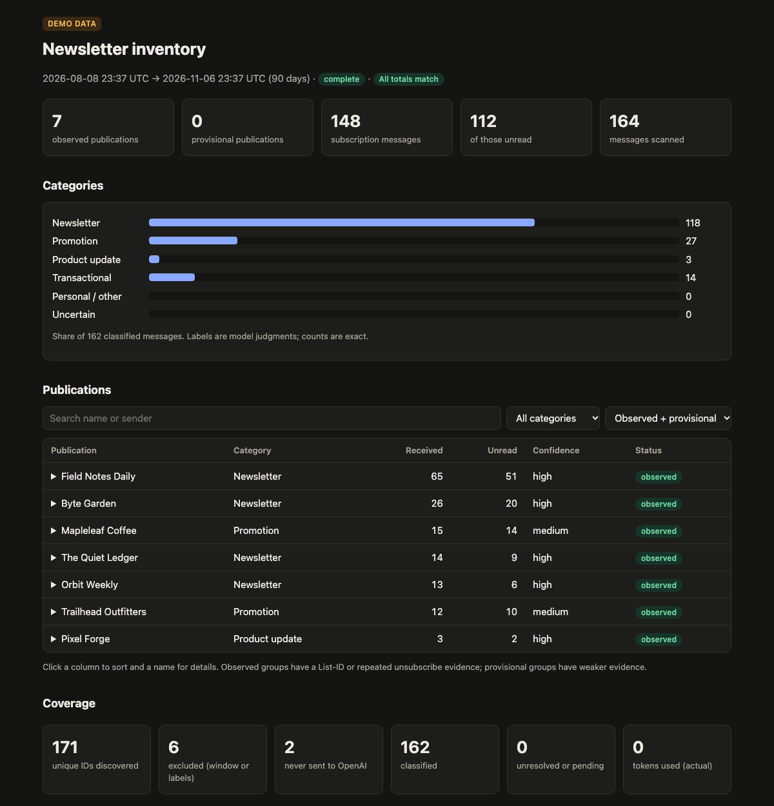
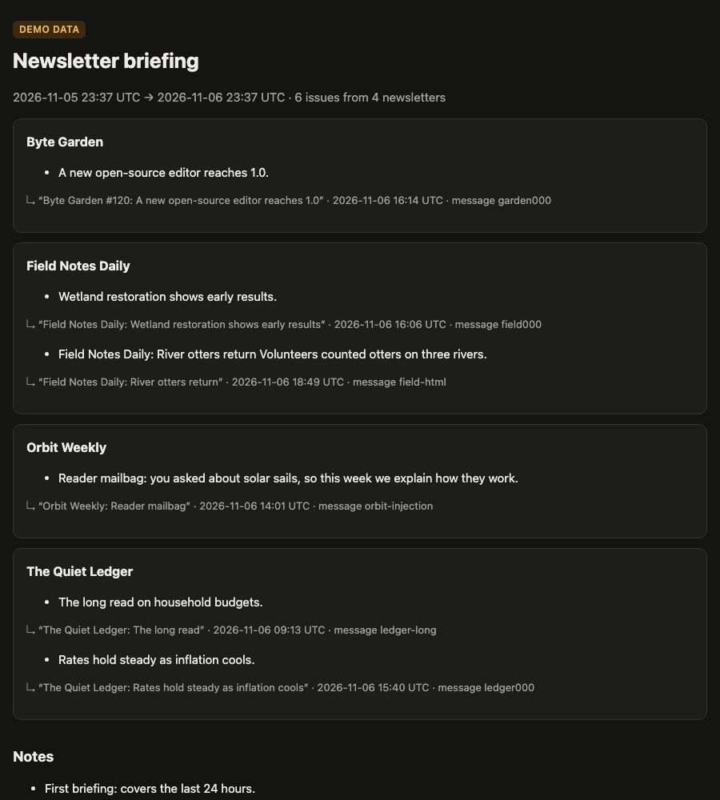
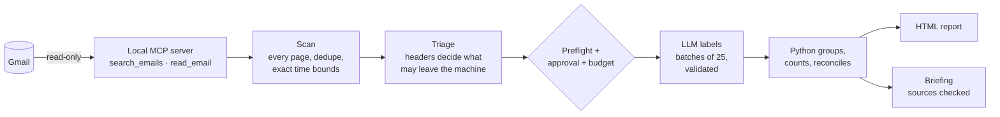

# newsletter-agent

[](https://github.com/yusenrong46-afk/newsletter-agent/actions/workflows/ci.yml)
[](LICENSE)


**Find out which newsletters actually fill your Gmail, then get a short daily briefing of the ones worth reading.**

It runs on your own computer, reads Gmail read-only through a local [MCP](https://modelcontextprotocol.io) server, and uses an LLM only for judgment calls. Every count is computed and checked in Python.

**[→ See the live demo report](https://yusenrong46-afk.github.io/newsletter-agent/)** · [demo briefing](https://yusenrong46-afk.github.io/newsletter-agent/briefing.html). Both are built from a synthetic mailbox by CI.



## What it does

- **Inventory:** scans 90 days of mail, including archived mail, and reports each newsletter or subscription with how much it sends and how much sits unread.
- **Briefing:** each morning, summarizes only *new* editorial newsletters. Every bullet cites the email it came from.
- **Chat:** answers questions like "what do I get most?" or "summarize Byte Garden from this week."
- **Safety:** before anything costs money, it shows a free preflight with the scope and a token estimate, asks for approval, and enforces a hard budget.

<details><summary>Demo briefing screenshot</summary>



</details>

## Try it in two minutes (no accounts needed)

```bash
uv tool install git+https://github.com/yusenrong46-afk/newsletter-agent
newsletter-agent demo --open
```

The demo runs the **real** pipeline: the MCP server, scan, triage, classification, grouping, reconciliation and briefing. It uses about 170 invented emails and an offline stand-in for the model. The mailbox includes deliberate edge cases:
- two newsletters sent through the same delivery service
- a shop that sends both promotions and receipts
- a friend's personal email
- a prompt-injection attempt
- a message deleted mid-scan

`newsletter-agent demo --real-model` sends only those synthetic emails to the real model, using your OpenAI key.

## Use it with your own Gmail

You bring your own Google OAuth client and OpenAI key, so your email never passes through anyone else's servers.

1. `newsletter-agent setup` shows what's missing.
2. Create a Google Cloud OAuth client: [docs/setup-google.md](docs/setup-google.md) (about 10 minutes, once).
3. `newsletter-agent login` grants read-only Gmail access.
4. Set `OPENAI_API_KEY`, or save it when prompted. It's stored in `~/.newsletter-agent/credentials/.env`.
5. `newsletter-agent inventory --preflight` is free: it scans and estimates cost without calling OpenAI.
6. `newsletter-agent inventory` shows the same preflight, asks y/N, then classifies.
7. `newsletter-agent report --open` opens the interactive HTML report.
8. `newsletter-agent brief --open` makes today's briefing; `newsletter-agent schedule 07:00` runs it daily (macOS).

| Command | What it does |
|---|---|
| `setup` | Checks configuration and shows the next step |
| `login` | Read-only Gmail authorization |
| `check [--gmail]` | Tests the local MCP server, and optionally Gmail |
| `inventory [--days N] [--preflight] [--max-messages N] [--resume] [--yes]` | Runs the inventory; budgets via `--max-model-calls` and `--max-tokens` |
| `report [--open]` | Latest HTML report |
| `brief [--yes] [--open]` | Summarizes new newsletter issues |
| `schedule HH:MM` / `unschedule` | Daily briefing with launchd, after explicit consent |
| `chat` | Asks about your newsletters |
| `demo [--open] [--real-model]` | Synthetic mailbox, real pipeline |

## How it works



The model's only job is to label messages (newsletter, promotion, receipt…) and write briefing bullets. Python owns pagination, grouping, arithmetic and validation. See [docs/architecture.md](docs/architecture.md).

## Design decisions and trade-offs

- **The model gives opinions; Python does the arithmetic.**
  - Counts come from stored records, and a reconciliation step recalculates every total a second way and flags any mismatch.
  - Invented, missing or duplicate message IDs in a model answer become explicit *unresolved* items, never silent "not a newsletter" results.
- **Privacy triage happens before any model call.**
  - Mail with mailing-list evidence sends an excerpt with links removed.
  - Repeat senders with no such evidence send headers only.
  - Everything else never leaves your computer.
  - Bodies are never written to disk, and personalized unsubscribe URLs are stored only as yes/no.
- **Exactly two read-only MCP tools.**
  - The inventory reaches Gmail only through the protocol, never by calling Google's library directly.
  - The model never gets Gmail tools.
  - Email text is treated as untrusted data in every prompt.
- **Grouping is conservative:**
  - by List-ID, otherwise by exact sender address, never by domain;
  - two newsletters on the same delivery service stay separate;
  - same-name groups are flagged, not merged.
- **Paid work is explicit:**
  - a free preflight, then one approval, then a hard per-run budget;
  - partial results on interruption, and `--resume` without double counting;
  - classifications are cached by message ID and prompt/schema version, so reruns are cheap.
- **Static HTML instead of a dashboard server:** no ports and no login. A Content-Security-Policy blocks every remote load, including tracking pixels.
- **Testing against reality found what mocks missed.** A real Ctrl-C on a live scan showed that an interrupted metadata read could break the totals, and that shutdown errors hid the saved report. A full 90-day scan of a real mailbox hit Gmail rate limits, so the retry count was raised. Each of these now has a regression test.

## Privacy and safety

- **Gmail scope:** `gmail.readonly` only. The agent cannot send, delete, label, mark as read or unsubscribe.
- **What leaves your computer:** only what triage allows, sent to OpenAI with `store=False`, and only after your approval or your explicit schedule consent.
- **Local data:** everything lives in `~/.newsletter-agent/`, with the folder mode 0700 and files 0600.

Details: [docs/privacy.md](docs/privacy.md).

## Limitations

- It inventories *observed* email. It doesn't prove what you're subscribed to or whether anything is paid.
- A newsletter with no mailing-list headers and fewer than 3 messages in the window isn't classified. The report lists those senders.
- One publication using two sender addresses appears as two groups.
- The first full scan reads messages one at a time, at roughly 3 per second. Reruns use the cache.
- Scheduling is macOS only; on Linux the `schedule` command prints a cron line instead. There's no hosted or multi-user version, by design.

## Development

```bash
git clone https://github.com/yusenrong46-afk/newsletter-agent && cd newsletter-agent
uv sync
uv run pytest            # offline; synthetic email only
uv run newsletter-agent demo --open
```

## License

[MIT](LICENSE) © 2026 Yusen Rong
